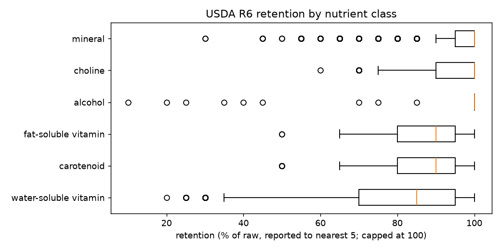
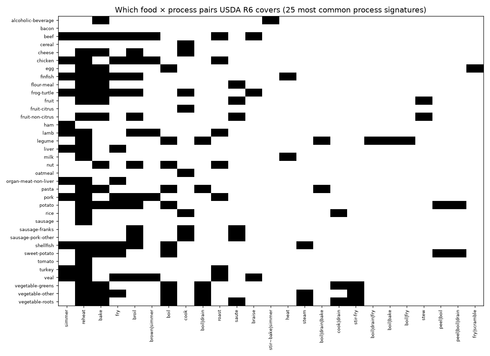

# DEL-1 data card + EDA — evidence ledger v0

Ledger `ledgers/evidence/evidence_v0.jsonl` · sha256 `cf5a1f7c4cc0157a…` · built from `SNAP-0001` (USDA Retention Factors R6, CC0).

## 1. Provenance and licence

| Source | Rows | Licence | Raw storage | Origin type | Tier |
|---|---|---|---|---|---|
| SRC-0001 USDA Table of Nutrient Retention Factors, Release 6 (2007) | 7,018 | CC0 (catalog.data.gov) | allowed | DATABASE_AGGREGATE | E3 |

Phenol-Explorer 3.0 is **not yet ingested** (ADR 0002, awaiting H2). Literature rows: **0 verified**; the ≥40 required are blocked on human verification.

## 2. Size and duplication

- rows **7,018**; evaluable (E1–E4, no defect) **6,994**; defects **24** (retention code 5005: factor missing in source)
- retention codes (food category × preparation) **270**; ingredient categories **36**; targets **26**; distinct process signatures **47**
- **duplicate audit:** 143 codes share an identical full nutrient vector with another code (49 clusters) — consistent with USDA's documented imputation from similar foods/methods; grouped before any split (DEL-2 card §G)

## 3. Schema validity and availability

All rows validate against `EvidenceRow` v1 (Pydantic) on construction.

| Field | Available (non-UNKNOWN) |
|---|---|
| time | 10.4% (729 rows) |
| temperature | 0.0% (0 rows) |
| water handling | 6.3% (442 rows) |
| medium | 0.7% (52 rows) |
| state_in | 19.7% (1,378 rows) |
| food form | 43.1% (3,016 rows) |

Temperature is UNKNOWN for **every** row: R6 states preparation methods, not temperatures. Times are stated for some legume, milk and alcohol preparations only.

## 4. Distributions

Retention values are integer percent reported **to the nearest 5%**, with values above 100 reported as 100 (right-censored).

| Nutrient class | Rows | Median % | IQR | Share censored at 100 |
|---|---|---|---|---|
| alcohol | 269 | 100 | 100–100 | 97% |
| carotenoid | 1,345 | 90 | 80–95 | 23% |
| choline | 269 | 100 | 90–100 | 63% |
| fat-soluble vitamin | 538 | 90 | 80–95 | 23% |
| mineral | 2,152 | 100 | 95–100 | 65% |
| water-soluble vitamin | 2,421 | 85 | 70–95 | 15% |

**Process long tail:** 47 process signatures over 270 codes; the top 5 cover 50% of codes; 23 signatures occur once.

## 5. Coverage and sparsity

Ingredient × process-signature matrix: **36 × 47**, filled cells **172** of 1692 (**10.2%** density). At the code × nutrient level the table is nearly dense (6,994 of 7,020 cells). **Sparsity lives in which food×process pairs were ever studied, not in which nutrients were measured** — the case SX-13-04 models.

### 5b. Coverage of a real recipe vocabulary (K6/P12)

Against the A1 course corpus (115,197 ingredient mentions, 6,346 names; rule crosswalk `ledgers/ingredients/alias_a1_v0.csv`, all links PROPOSED):

| Outcome | Share of mentions |
|---|---|
| MAPPED_CATEGORY | 35.6% |
| NO_R6_CLASS | 25.1% |
| DERIVED_PRODUCT | 22.6% |
| MAPPED_CONCEPT | 11.3% |
| UNRESOLVED | 4.5% |
| A1_ARTEFACT | 0.9% |

Only **46.9%** of recipe ingredient mentions reach any R6 food, and only **11.3%** at concept level; the rest are category links (e.g. garlic → `VEG,OTHER`), derived products (stock, juice, purée), or classes R6 never measures (herbs, spices, fats, sugars). This bounds what DEL-4/5 can answer from R6 alone.

## 10. Bias audit

- food groups by number of preparation codes: group 11 53, group 15 40, group 10 38, group 13 26, group 17 23, group 16 19, group 20 14, group 1 13, group 5 13, group 9 13, group 14 10, group 8 4, group 12 4
- **US-centric** (USDA, 1975–2007 compilations); **no Indian preparations** (tadka, dum, pressure cooking) are covered — relevant to the Indian-recipe use case
- category-level foods (e.g. `VEG,ROOTS,ETC`) dominate several groups → linking to specific RecipeDB ingredients is one-to-many
- source-level imputation (USDA-documented) cannot be separated per row

## 13. Hypotheses generated (logged at ladder L1 — **not** claims)

| ID | Pattern | Basis |
|---|---|---|
| HYP-0001 | Water-soluble vitamins show lower retention than minerals across preparations in R6 | EDA §4 medians |
| HYP-0002 | Processes that discard cooking water retain less of water-soluble vitamins than those that consume it | water-handling field |
| HYP-0003 | Study coverage (which food×process pairs exist) is non-random by food group | EDA §5 density |
